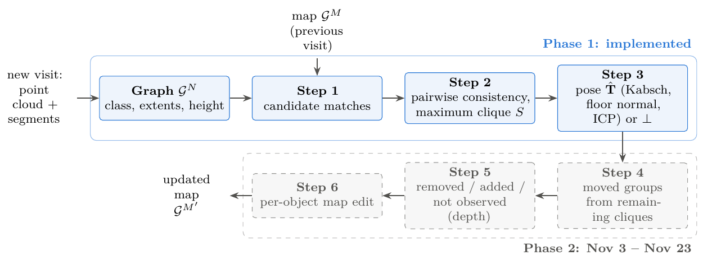
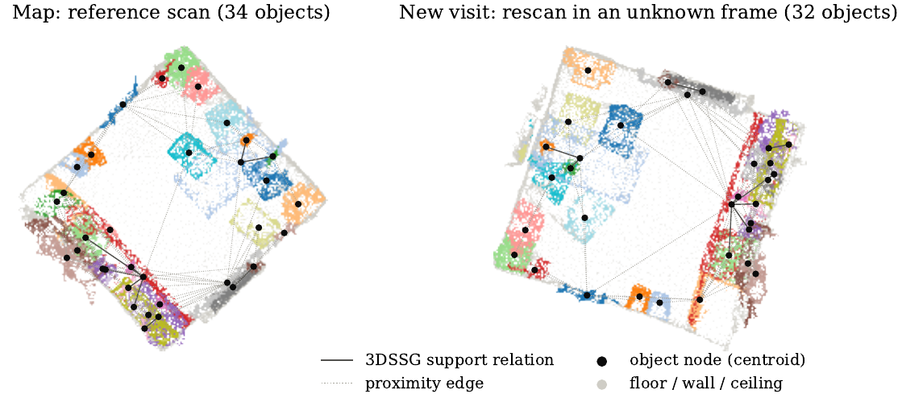
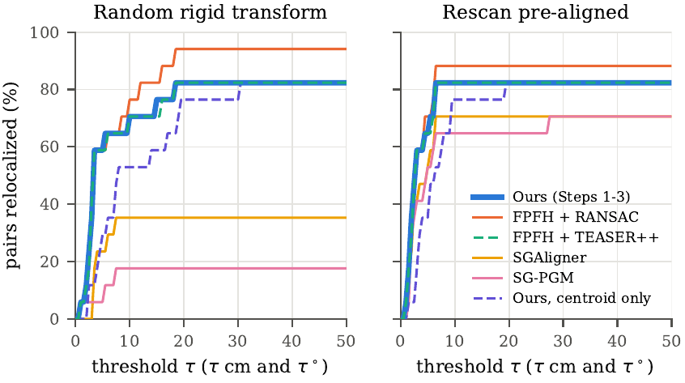
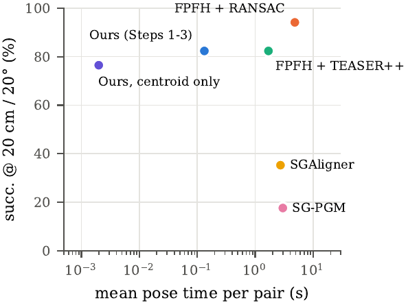
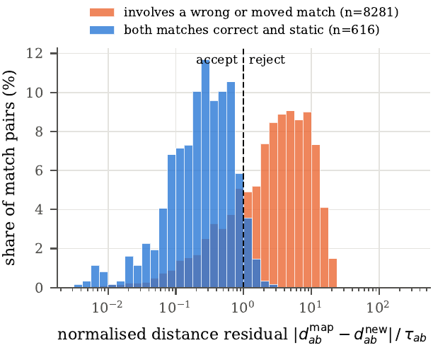
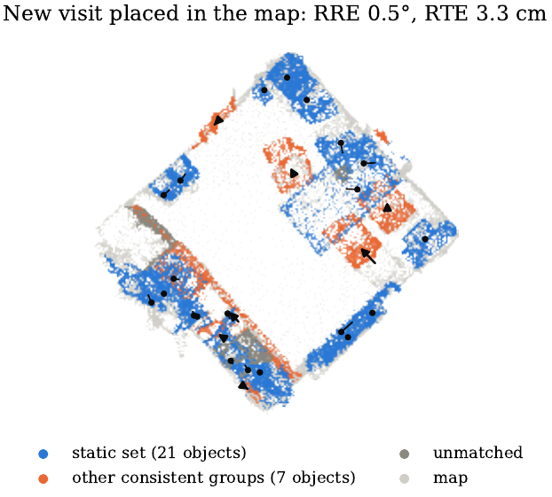

# LM-3DCD-SG: Lifelong Mapping & 3D Change Detection on Object-Level Scene Graphs

Training-free relocalization and change detection for a robot that revisits a changing indoor scene with a map from an
earlier visit. The map is an object-level 3D scene graph. On every visit the robot builds a graph of what it currently sees,
matches it to the map, recovers its pose without an initial guess, labels each object as static, moved, added, removed or
not observed, and edits the map per object.

CS7.503 Mobile Robotics (IIIT Hyderabad) course project by **Ch Shreyash** (2024121008), **Farzana S** (2024121006) and
**Prajas Wadekar** (2024121009).

| Document | File |
|---|---|
| **Mid-submission report (Phase 1)** | [`report/main.pdf`](report/main.pdf) (LaTeX source in [`report/`](report/)) |
| Proposal and timeline | [`docs/proposal_timeline.pdf`](docs/proposal_timeline.pdf) (course LaTeX template: [`docs/proposal_timeline.tex`](docs/proposal_timeline.tex)) |

**Status (Oct 2026)**

| Phase | Due | Scope | Status |
|---|---|---|---|
| Phase 1 | mid-submission, Oct 26 | data loading, graph construction, Steps 1–3, two-visit relocalization, baselines | ✅ done |
| Phase 2 | final, Nov 23 | Steps 4–6, multi-visit setting, predicted segments | planned |
| Demo | Nov 26 | relocalization, change detection and map editing on 3RScan rooms | planned |



---

## Method (Phase 1)

**Graph construction.**
- Inputs per scan: the annotated instance segments and semantic labels from 3RScan, and the 3DSSG relations.
- Floor, wall and ceiling segments become structural nodes. Every other segment with at least 50 points becomes an object node, which stores its points, centroid $\mathbf c$, class, height above the fitted floor plane $h$, and change history.
- Object extents $\mathbf e$ do not depend on the robot's pose:
  - the vertical extent is measured along the floor normal;
  - the two horizontal extents come from the minimum-area bounding rectangle of the object's footprint. PCA axes are unstable for square footprints.
- Edges are 3DSSG relations plus proximity edges.

**Step 1: candidate matches.** Objects of the same class are compared with

$$\kappa(a,b)=\sum_{k=1}^{3}\bigl|\log(e_{a,k}+\epsilon)-\log(e_{b,k}+\epsilon)\bigr|+\frac{|h_a-h_b|}{\sigma_h}.$$

Each object keeps its $k=3$ cheapest counterparts, in both directions. Identical objects therefore get several candidates, and the choice between them is left to geometry in Step 2.

**Step 2: largest consistent set.** Two candidate matches $(a,b)$ and $(a',b')$ are compatible when three conditions hold:
- they are one-to-one;
- the distance between the two objects is the same in both visits;
- the height difference between the two objects is the same in both visits.

Each test uses the tolerance $\tau=\varepsilon+\beta(r+r')$, where the $r$ terms are the object radii, because the centroid of a partly seen large object shifts. The maximum clique of the compatibility graph is the **static set** $S$. Re-solving on the remaining candidates gives further cliques, which are candidate groups of objects that **moved together** (input to Step 4).

**Step 3: pose.**
1. Solve a weighted Kabsch/Umeyama alignment on the centroids of $S$, with the two floor normals added as an extra direction pair.
2. Refine with point-to-plane ICP on the points of $S$ and the structural nodes.
3. Return failure ($\bot$) instead of a pose if $|S|<3$, the centroids are collinear, or the ICP fitness is below 0.3.

All parameters are in [`configs/default.yaml`](configs/default.yaml). They were chosen only on 6 **train** rooms ([`configs/dev.yaml`](configs/dev.yaml)), never on the validation pairs.

<p align="center"></p>

## Evaluation protocol

Every method sees exactly the same input:
- **Pairs.** A 3RScan reference scan is the map and one of its rescans is the new visit. Phase 1 uses the annotated segments.
- **Random transform.** Each pair has one stored random rigid transform: a uniform rotation on SO(3) and a translation drawn from U(−2, 2)³ m. It is applied to the rescan before any method sees it ([`data/pairs_val.json`](data/pairs_val.json)).
- **Ground truth.** $\mathbf T^\star = \mathbf T_{\text{rescan}\to\text{ref}}\,\mathbf T_\text{rand}^{-1}$, using the transform from `3RScan.json`, which is stored column-major. It is used only for scoring.
- **Metrics:**
  - success at the RIO thresholds, 10 cm / 10° and 20 cm / 20°;
  - registration recall (RMSE of the visit's points below 0.2 m, as in SGAligner, SG-PGM and SG-Reg);
  - median rotation (RRE) and translation (RTE) error;
  - time per pair.
- **Failures.** A pair on which a method declines to return a pose counts as a failure.
- **Aligned run.** A second run gives the rescan already aligned to the reference. This is the setting the learned baselines were trained and evaluated in, and it also checks that their adapters work.

## Results (Phase 1, validation subset: 4 rooms, 17 pairs)

This is a small subset: one pair is about 6 points of success rate. The full validation split (47 rooms) is the first item for Phase 2.

| Method | Pose returned | succ. 10cm/10° | succ. 20cm/20° | RR@0.2m | median RRE | median RTE | time/pair | succ. 20/20, pre-aligned |
|---|---|---|---|---|---|---|---|---|
| SGAligner (ICCV'23) | 47.1% | 35.3% | 35.3% | 35.3% | 1.24° | 4.7 cm | 2.73 s | 70.6–76.5% |
| SG-PGM (CVPR'24) | 100% | 17.6% | 17.6% | 17.6% | 80.2° | 145 cm | 2.99 s | 64.7% |
| FPFH + TEASER++ | 100% | 70.6% | 82.4% | 82.4% | 1.07° | 3.2 cm | 1.69 s | 82.4% |
| FPFH + RANSAC | 100% | **76.5%** | **94.1%** | **94.1%** | 1.07° | 3.2 cm | 4.82 s | 88.2% |
| Ours, centroid pose only | 94.1% | 52.9% | 76.5% | 82.4% | 1.55° | 7.6 cm | <0.01 s | 82.4% |
| **Ours (Steps 1–3)** | 94.1% | 70.6% | 82.4% | 82.4% | **0.99°** | 3.3 cm | **0.13 s** | 82.4% |

<p align="center"> </p>

**Invariance.**
- Our accuracy is the same with and without the random transform.
- The learned scene-graph aligners collapse under it: SGAligner drops from 71–76% to 35%, and SG-PGM from 65% to 18%.
- Their node encoders take object points in world coordinates. SG-PGM's own random-transform evaluation rotated only the registration points, never the scene-graph objects.

**Accuracy and cost.**
- Ours matches FPFH+TEASER++ and is two pairs behind FPFH+RANSAC, at 37× lower cost.
- Steps 1–2 take about 1.5 ms per pair; ICP takes the remaining 0.13 s.
- Ours also returns object correspondences and the static set, which the change-detection steps need.

**Failure modes.**
- **Repeated layouts:** a café with a row of identical table, chair and menu sets. Shifting by one set gives a consistent group of 8 objects, larger than the correct group of 7.
- **Too few objects:** a rescan that sees only 6 objects, so we decline.
- **Everything moved:** rooms where every object moved (dev set). Declining is the correct object-level answer there, but structure-only registration would still recover the pose.

| | |
|---|---|
|  |  |
| Pairwise test on all candidate pairs: it keeps 94.5% of pairs between correct, unchanged matches and 25.6% of the rest. The maximum clique removes the remainder. | One pair after relocalization (RTE 3.3 cm): the static clique (blue), and the remaining consistent groups (orange), which are candidates for Step 4. |

Per-pair outcomes: [`docs/img/per_pair.png`](docs/img/per_pair.png). Raw results: [`results/`](results/), with one JSON line per pair and method, plus `per_pair.csv` and `two_visit_table*.md`.

## Baselines

| Method | How it is run here |
|---|---|
| **SG-PGM** (CVPR'24), strongest scene-graph aligner with public 3RScan weights | released checkpoint and the repo's own model, dataset class and collate function ([`baselines/adapters/run_sgpgm.py`](baselines/adapters/run_sgpgm.py)) |
| **SGAligner** (ICCV'23) | released checkpoint with K=2 node matches, GeoTransformer (3DMatch) and GC-RANSAC ([`baselines/adapters/run_sgaligner.py`](baselines/adapters/run_sgaligner.py)) |
| **FPFH + RANSAC** | Open3D: 5 cm voxels, mutual filter, then point-to-plane ICP ([`scripts/run_classical.py`](scripts/run_classical.py)) |
| **FPFH + TEASER++** | TEASER++ (GNC-TLS, max clique) on mutual nearest-neighbour FPFH matches, then ICP |
| SG-Reg (T-RO'25), SGAligner++ (2025) | cited only: SG-Reg releases only a ScanNet-trained model and a C++ back-end; SGAligner++ has no code |

Both learned checkpoints were trained on the 3RScan **train** split, and all evaluation rooms come from **val**.

**Adapter.** [`export_scan3r.py`](baselines/adapters/export_scan3r.py) writes our pairs, including the stored random transforms, into SGAligner's full-scan data layout. SGAligner's own unmodified preprocessing then builds the per-scan pickles (attribute vocabulary 164, relations 41, matching the checkpoints). SG-PGM reads the same files.

**Fairness fixes** (each one helps the baselines):
- **SGAligner's RANSAC.** GC-RANSAC's PROSAC sampler requires correspondences sorted by score. With pip `pygcransac==0.1.1`, unsorted input returns no model even on synthetic data with 50% inliers. [`baselines/patches/sgaligner.patch`](baselines/patches/sgaligner.patch) sorts by GeoTransformer score and retries with the uniform sampler. The same patch replaces the hard-coded dataset path with `$SCAN3R_ORIG_DIR`.
- **Normal orientation for FPFH.** Normals are oriented towards the scan centre. Open3D's default sign depends on the frame, and without the fix FPFH+TEASER++ dropped from 82% to 41% under the random transform.
- **3DSSG `inside` relations** are removed before SGAligner preprocessing, which rejects them.

## Repository layout

```
lifelong/                  the method
  data.py                  3RScan metadata/scans, 3DSSG objects & relationships
  graph.py                 scene-graph construction (pose-invariant extents, floor plane, edges)
  candidates.py            Step 1
  consistency.py           Step 2 (compatibility matrix, maximum clique, further consistent groups)
  pose.py, relocalize.py   Step 3 and the end-to-end call
  protocol.py, metrics.py, transforms.py, config.py
configs/                   default.yaml (all thresholds), dev.yaml (train rooms used for tuning)
scripts/
  download_subset.py       N validation rooms from a 3RScan mirror (labels + semseg + segs only)
  make_pairs.py            pairs + stored random SE(3) (--aligned: pre-aligned sanity setting)
  run_ours.py              ours + centroid-only ablation       -> results/ours*.jsonl
  run_classical.py         FPFH+RANSAC, FPFH+TEASER++          -> results/fpfh_*.jsonl
  evaluate.py              one scorer for all methods          -> results/two_visit_table*.md, per_pair*.csv
  make_figures.py          every figure of the report          -> report/figures/*.pdf
  run_all.sh               tests -> pairs -> all methods -> evaluation
baselines/
  setup_baselines.sh       fetch pinned upstream commits, apply patch, build extensions, download weights
  patches/                 sgaligner.patch
  adapters/                export_scan3r.py, prepare_baselines.sh, run_sgaligner.py, run_sgpgm.py, configs/
  requirements_sgbase.txt  exact package versions of the baseline environment
tests/test_pipeline.py     synthetic rooms: Kabsch, pose invariance, duplicates, moved group, declining
report/                    mid-submission report: main.tex (course template, 11pt), references.bib, figures/, main.pdf
docs/                      proposal (PDF + LaTeX template + references.bib) and README images
```

## Setup

**1. Our method and the classical baselines** (env `mrproj`):

```bash
conda env create -f environment.yml          # python 3.10, open3d 0.18, python-igraph, eigen 3.4, ...
conda activate mrproj
pytest -q tests                              # 8 synthetic tests
```

**2. Data.** Downloading 3RScan requires its [Terms of Use](https://github.com/WaldJohannaU/3RScan); the official route is the ToU form, which gives you a `download.py` script. Put the files in this layout:

```
data/meta/   3RScan.json, train_scans.txt, val_scans.txt         (campar.in.tum.de/public_datasets/3RScan/)
             objects.json, relationships.json                     (campar.in.tum.de/public_datasets/3DSSG/3DSSG/)
data/3RScan/<scan_id>/labels.instances.annotated.v2.ply, semseg.v2.json, mesh.refined.0.010000.segs.v2.json
```

[`scripts/download_subset.py`](scripts/download_subset.py) fetches N validation rooms (reference + rescans) from the Hugging Face dataset mirror [`maartenImjalli143/3RScan`](https://huggingface.co/datasets/maartenImjalli143/3RScan). That is what was used here: `--rooms 4`.

**3. Learned baselines** (env `sgbase`):
- Python 3.11 with torch 2.7.1+cu128 (tested on an RTX 2080 Ti, sm_75).
- Exact versions are in [`baselines/requirements_sgbase.txt`](baselines/requirements_sgbase.txt). In particular pin `torch_geometric==2.5.3`, because newer versions route `knn_graph` to pyg-lib.

```bash
conda create -n sgbase python=3.11 && conda activate sgbase
pip install torch==2.7.1 torchvision==0.22.1 --index-url https://download.pytorch.org/whl/cu128
pip install torch_geometric==2.5.3 \
  https://data.pyg.org/whl/torch-2.7.0%2Bcu128/torch_cluster-1.6.3%2Bpt27cu128-cp311-cp311-linux_x86_64.whl \
  open3d==0.18.0 numpy==1.26.4 pygcransac plyfile scipy yacs easydict einops coloredlogs tqdm pyyaml ipdb \
  scikit-learn tensorboard tensorboardX trimesh torchsummary addict pyquaternion opencv-python-headless gdown
CUDA_HOME=/usr/local/cuda bash baselines/setup_baselines.sh   # SGAligner, SG-PGM, TEASER++ + weights
```

## Reproducing the results and the report

```bash
bash scripts/run_all.sh                       # ~15 min on the 17-pair subset (GPU for SGAligner / SG-PGM)
python scripts/make_figures.py                # report/figures/*.pdf
cd report && tectonic -X compile main.tex     # or: latexmk -pdf main.tex
```

The thresholds were tuned on the dev rooms with:

```bash
python scripts/make_pairs.py --config configs/dev.yaml
python scripts/run_ours.py --config configs/dev.yaml --out-dir results/dev
python scripts/evaluate.py --config configs/dev.yaml --results results/dev
```

On dev, ours gets 86.4% with no wrong poses, and both FPFH baselines get 95.5%.

## Models and artefacts

No models were trained in this project, so there are no Hugging Face or WandB model artefacts. The only Hugging Face resource used is the 3RScan dataset mirror [`maartenImjalli143/3RScan`](https://huggingface.co/datasets/maartenImjalli143/3RScan). The baseline checkpoints are the authors' releases:

| Checkpoint | Source |
|---|---|
| SGAligner | [Google Drive](https://drive.google.com/drive/folders/10-JNxWLxPFQ2q6_zY-9HXIO-Qx-vhmmT) |
| SG-PGM | [Google Drive](https://drive.google.com/drive/folders/1E60DFV7uTdvwgIxf6_eTIbayQH7uYZzP) |
| GeoTransformer (3DMatch) | [GitHub release](https://github.com/qinzheng93/GeoTransformer/releases/tag/1.0.0) |

## Upstream code

| Code | Commit | Notes |
|---|---|---|
| [SGAligner](https://github.com/sayands/sgaligner) | `51cd572` | its [GeoTransformer](https://github.com/sayands/GeoTransformer) submodule at `9bba304` |
| [SG-PGM](https://github.com/dfki-av/sg-pgm) | `233d852` | unmodified |
| [TEASER++](https://github.com/MIT-SPARK/TEASER-plusplus) | `52a9c52` | |

## References

The full bibliography is in [`report/references.bib`](report/references.bib). The key works:

| Work | Venue |
|---|---|
| RIO / 3RScan (Wald et al.) | ICCV 2019 |
| 3DSSG (Wald et al.) | CVPR 2020 |
| SGAligner (Sarkar et al.) | ICCV 2023 |
| SG-PGM (Xie et al.) | CVPR 2024 |
| SG-Reg (Liu et al.) | T-RO 2025 |
| PCM (Mangelson et al.) | ICRA 2018 |
| TEASER (Yang et al.) | T-RO 2021 |
| CLIPPER (Lusk et al.) | ICRA 2021 |
| Objects Can Move (Adam et al.) | ECCV 2022 |
| Living Scenes (Zhu et al.) | CVPR 2024 |
| Khronos (Schmid et al.) | RSS 2024 |
